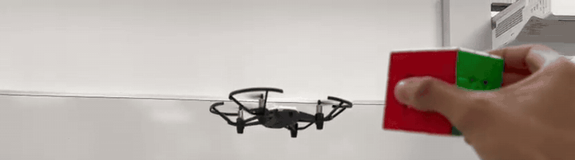
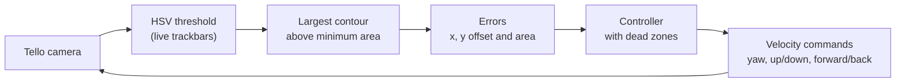
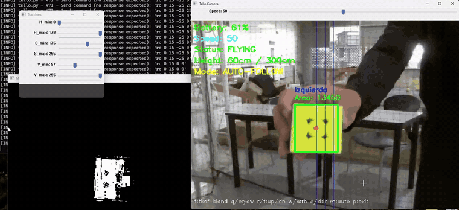
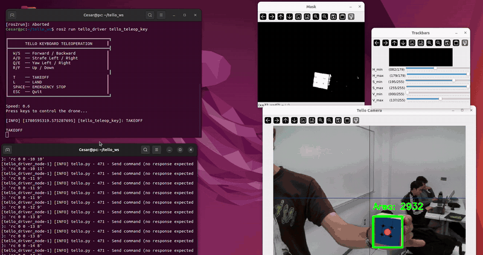
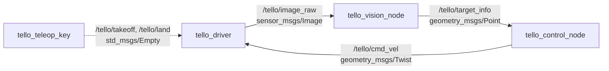
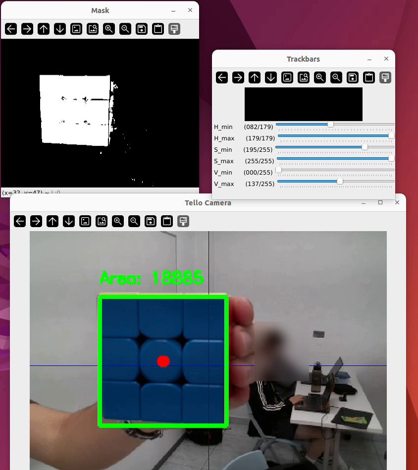
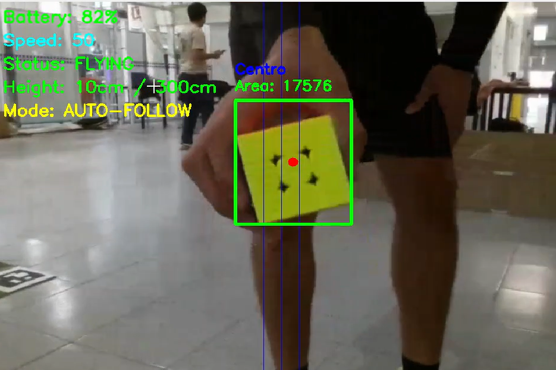

# Tello UAV Visual Tracking

Vision-based target tracking for a **DJI Tello** quadcopter. The UAV detects a colored object with OpenCV, and steers in yaw, altitude and distance to keep it centered in the camera image and at a fixed range.

The repository contains two implementations of the same idea:

| | [`standalone/`](standalone/) | [`ros2/`](ros2/) |
| --- | --- | --- |
| Stack | Python, `djitellopy`, OpenCV | ROS 2 Humble, `rclpy`, OpenCV |
| Structure | One script with its own HUD | Driver, vision and control nodes |
| Controller | Fixed-speed steps with dead zones | Proportional with dead zones and saturation |
| Extras | Keyboard teleoperation, battery and height safety | Topic-based, each node replaceable on its own |

Built at Tecnológico de Monterrey, Campus Querétaro (2026).



## How it works

Both versions share the same pipeline:



1. **Segmentation.** Each frame is converted to HSV and thresholded with `cv2.inRange`. The six HSV limits are trackbars, so the color can be calibrated live for the lighting in the room.
2. **Target selection.** External contours are extracted from the mask. The largest one above a minimum area is the target, and the center of its bounding box is the measured position.
3. **Errors.** The horizontal and vertical offsets from the image center drive yaw and altitude. The contour area works as a distance estimate: a smaller area means the target is farther away.
4. **Control.** Each axis has a dead zone, so the UAV holds still when the target is close enough to the setpoint instead of oscillating around it.

| Measurement | Controls | Effect |
| --- | --- | --- |
| Horizontal offset (px) | Yaw rate | Turns to face the target |
| Vertical offset (px) | Vertical speed | Climbs or descends to its height |
| Contour area (px²) | Forward speed | Approaches or backs away to hold distance |

## Standalone tracker

A single script that talks to the Tello directly. It combines keyboard teleoperation, an on-screen HUD (battery, speed, flight status, height, mode) and an auto-follow mode that can be toggled in flight. Manual control stays available as a fallback at all times.



Safety logic built in:

- Takeoff is refused at 15% battery or less, and the UAV lands by itself below 10%.
- Climbing is blocked above 300 cm.
- The UAV lands and the video stream is closed on exit, on `Ctrl+C` and on any exception.

Details and controls: [`standalone/README.md`](standalone/README.md)

## ROS 2 version

The same tracker split into nodes that communicate over topics. The vision node only measures, the control node only decides, and the driver is the only one that talks to the UAV.



The recording shows a full session in flight. The lower terminal is the driver sending the RC commands computed by the controller, and the camera window shows the detected target with its area.



The controller is proportional on all three axes, with dead zones and saturated outputs:

```
yaw      =  0.002   · error_x              if |error_x| > 25 px
vertical = -0.002   · error_y              if |error_y| > 25 px
forward  =  0.00002 · (5000 - area)        if |5000 - area| > 2800 px²
```

If the target is lost, the vision node reports an area of zero and the controller commands a full stop.

Details, topics and launch instructions: [`ros2/README.md`](ros2/README.md)

## Quick start

Connect the computer to the Tello's WiFi network first.

**Standalone**

```bash
cd standalone
pip install -r requirements.txt
python tello_tracker.py
```

**ROS 2**

```bash
cd ~/ros2_ws/src
git clone https://github.com/glascurain4/tello-uav-visual-tracking.git
cd ~/ros2_ws
pip install djitellopy
colcon build --packages-select tello_driver
source install/setup.bash
ros2 launch tello_driver tracking_launch.py
```

## Results

| ROS 2 version | Standalone tracker |
| --- | --- |
|  |  |

- The UAV keeps the target centered while regulating its distance at the same time, on three axes.
- Small gains in the ROS 2 controller give smooth, damped corrections instead of abrupt maneuvers.
- The dead zones remove the jitter caused by pixel-level noise in the detection.

## Limitations and future work

- **Lighting.** A fixed HSV threshold is sensitive to shadows, reflections and changes in daylight, so it needs recalibration per room. An adaptive threshold based on the image histogram would reduce this.
- **Distance estimate.** Contour area is a rough, non-linear proxy for range and depends on the target's orientation.
- **Distractors.** The largest contour always wins, so a bigger object of the same color pulls the UAV away from the target.
- **Control.** Proportional only. A PID per axis would remove steady-state error and compensate for the lag in the UAV's response.

## Repository structure

```
tello-uav-visual-tracking/
├── standalone/
│   ├── tello_tracker.py         # teleoperation + HUD + color tracking in one script
│   └── requirements.txt
├── ros2/
│   └── tello_driver/            # ROS 2 package (ament_python)
│       ├── tello_driver/
│       │   ├── tello_driver_node.py    # UAV interface: video out, cmd_vel in
│       │   ├── tello_teleop_key.py     # keyboard teleoperation
│       │   ├── tello_vision_node.py    # HSV segmentation and target errors
│       │   └── tello_control_node.py   # proportional controller
│       ├── launch/
│       └── config/
└── docs/img/
```

## Team

- Gabriel Lascurain
- José Vivanco
- César Nuño

Robotics and Digital Systems Engineering, Tecnológico de Monterrey, Campus Querétaro.

Thanks to our professor Josué González García for his guidance. He is also the author of the base ROS 2 driver and teleoperation nodes that the vision and control nodes are built on.

## License

MIT, see [LICENSE](LICENSE).
