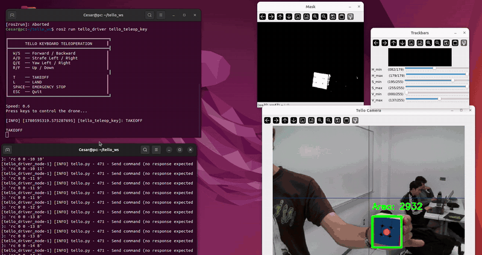
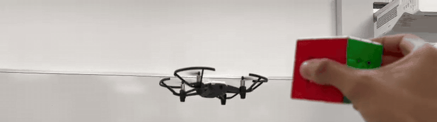
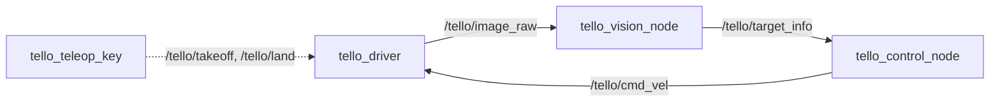
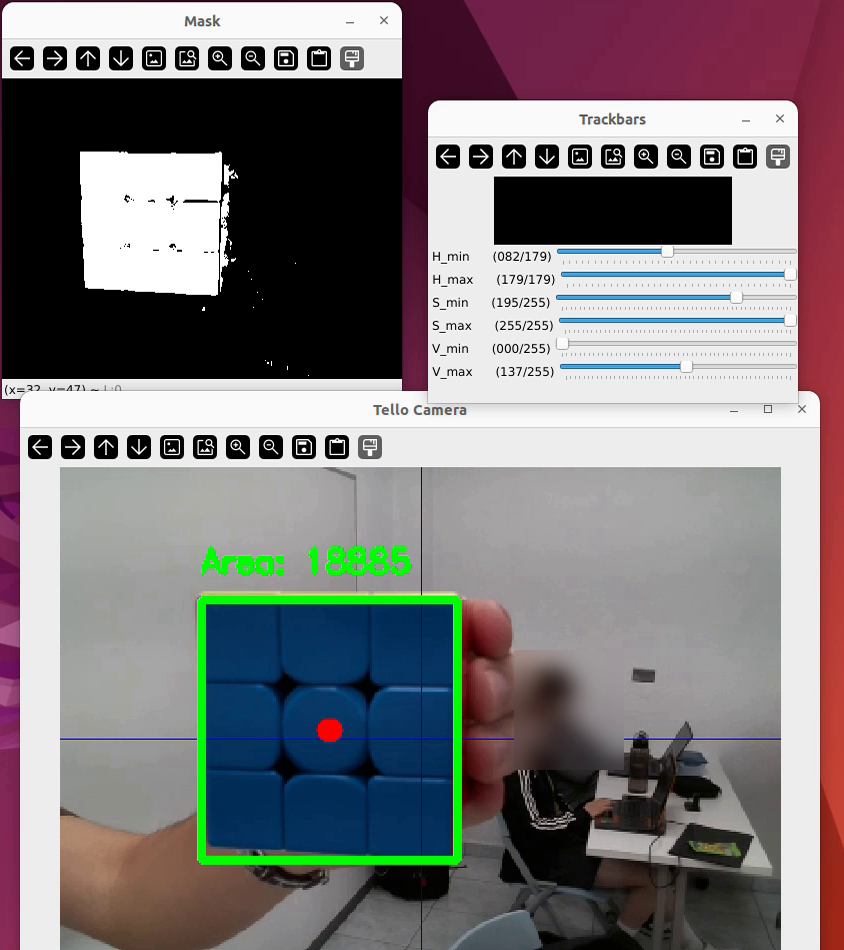

# ROS 2 version

The tracker as a ROS 2 Humble package, [`tello_driver`](tello_driver/). Perception and control are separate nodes connected by topics, so either one can be replaced without touching the other.





## Nodes



| Node | Role |
| --- | --- |
| `tello_driver` | Connects to the UAV, publishes the camera stream, battery and state, and turns `cmd_vel` into RC commands |
| `tello_vision_node` | HSV segmentation, largest contour, publishes the target errors |
| `tello_control_node` | Proportional controller from target errors to velocity commands |
| `tello_teleop_key` | Keyboard teleoperation, also used for takeoff and landing |

`tello_vision_node`, `tello_control_node` and `tracking_launch.py` are our work. `tello_driver` and `tello_teleop_key` are the base package by Josué González-García. In the driver we lowered the default output resolution to 400×300 to keep the image pipeline fluid.

## Topics

| Topic | Type | Publisher | Subscriber |
| --- | --- | --- | --- |
| `/tello/image_raw` | `sensor_msgs/Image` | driver | vision |
| `/tello/target_info` | `geometry_msgs/Point` | vision | control |
| `/tello/cmd_vel` | `geometry_msgs/Twist` | control, teleop | driver |
| `/tello/takeoff`, `/tello/land`, `/tello/emergency` | `std_msgs/Empty` | teleop | driver |
| `/tello/battery` | `std_msgs/Int32` | driver | |
| `/tello/state` | `std_msgs/String` | driver | |
| `/tello/camera_info` | `sensor_msgs/CameraInfo` | driver | |

`/tello/target_info` packs the measurement into a `Point`:

| Field | Content |
| --- | --- |
| `x` | Horizontal error in pixels (target center minus image center) |
| `y` | Vertical error in pixels |
| `z` | Contour area in px². Zero means the target is lost |

## Vision node

1. Resize the frame to 400×300 and convert it to HSV.
2. Threshold with `cv2.inRange` using six live trackbars. The defaults isolate a blue target: H 82 to 179, S 195 to 255, V 0 to 137.
3. Extract external contours and keep the largest one above 500 px².
4. Publish the offsets from the image center `(200, 150)` and the area.



The image subscription uses best-effort QoS to match the driver's sensor stream. The node shows the annotated camera view and the mask, and writes `TARGET LOST` on the image when nothing passes the area filter.

## Control node

Proportional control with a dead zone per axis:

```
angular.z =  0.002   · error_x          if |error_x| > 25 px,    else 0
linear.z  = -0.002   · error_y          if |error_y| > 25 px,    else 0
linear.x  =  0.00002 · (5000 - area)    if |5000 - area| > 2800, else 0
linear.y  =  0
```

The vertical gain is negative because image `y` grows downward: a target below the center means the UAV has to descend.

Outputs are saturated to ±0.2 on the linear axes and ±0.4 in yaw. The driver scales `cmd_vel` by 100 into the Tello's RC range, so these limits correspond to 20% and 40% of full stick.

| Parameter | Value | Meaning |
| --- | --- | --- |
| `threshold_x`, `threshold_y` | 25 px | Dead zone around the image center |
| `target_area` | 5000 px² | Area that corresponds to the desired distance |
| `area_threshold` | 2800 px² | Dead zone for the distance axis |
| `K_yaw`, `K_up_down` | 0.002 | Gain magnitude for yaw and altitude |
| `K_forward` | 0.00002 | Gain for the distance axis |

When the target is lost the node publishes a zero `Twist`. On shutdown it sends one last stop command.

## Build

Requires Ubuntu 22.04 with ROS 2 Humble, `cv_bridge` and OpenCV.

```bash
cd ~/ros2_ws/src
git clone https://github.com/glascurain4/tello-uav-visual-tracking.git
cd ~/ros2_ws
pip install djitellopy
colcon build --packages-select tello_driver
source install/setup.bash
```

## Run

Connect the computer to the Tello's WiFi network.

```bash
# Terminal 1: driver + vision + control
ros2 launch tello_driver tracking_launch.py

# Terminal 2: keyboard node, for takeoff (T) and landing (L)
ros2 run tello_driver tello_teleop_key
```

Calibrate the HSV trackbars with the target in view before taking off. Once the UAV is in the air it starts following as soon as the target passes the area filter.

Takeoff and landing can also be sent directly:

```bash
ros2 topic pub --once /tello/takeoff std_msgs/msg/Empty
ros2 topic pub --once /tello/land std_msgs/msg/Empty
```

Other launch files:

| Launch file | Starts |
| --- | --- |
| `tracking_launch.py` | Driver, vision and control |
| `tello_bringup.launch.py` | Driver and keyboard teleoperation (in an `xterm`) |
| `tello_driver.launch.py` | Driver only |

## Safety in the driver

- If no `cmd_vel` arrives for 0.5 s while flying, the driver sends a zero RC command.
- Battery is published every 5 s, with a warning in the log below 15%.
- The UAV lands when the driver node shuts down.
