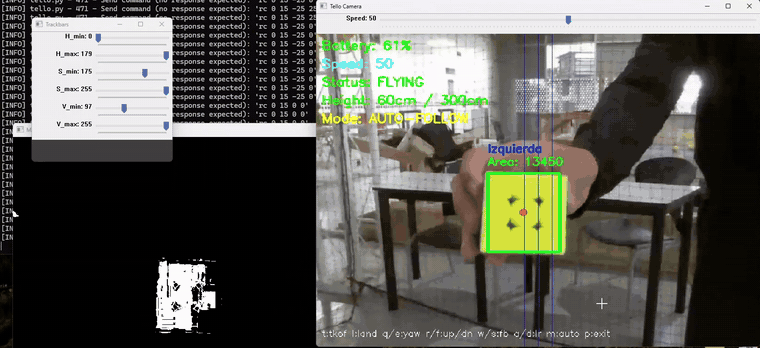

# Standalone tracker

One Python script, [`tello_tracker.py`](tello_tracker.py), that connects to the Tello with `djitellopy` and runs teleoperation, the HUD and color tracking in a single loop.



## Run

Connect the computer to the Tello's WiFi network, then:

```bash
pip install -r requirements.txt
python tello_tracker.py
```

Three windows open: the camera view with the HUD, the HSV trackbars and the binary mask.

## Controls

The camera window must have keyboard focus.

| Key | Action |
| --- | --- |
| `t` / `l` | Takeoff / land |
| `w` / `s` | Forward / backward |
| `a` / `d` | Left / right |
| `r` / `f` | Up / down |
| `q` / `e` | Rotate left / right |
| `m` | Toggle auto-follow |
| `p` | Exit (lands first if flying) |

The **Speed** trackbar on the camera window sets the command magnitude from 0 to 100 for both manual and automatic motion.

## Calibrating the color

1. Hold the target in front of the camera before taking off.
2. Move the six HSV trackbars until only the target is white in the **Mask** window.
3. Take off with `t` and switch to auto-follow with `m`.

Every contour above the minimum area is boxed and labeled with its area and its side of the image. The largest one is the target.

## Auto-follow logic

The frame is resized to 800×600. With the target center at `(x, y)` and the image center at `(400, 300)`:

| Axis | Condition | Command |
| --- | --- | --- |
| Yaw | `x` more than 25 px off center | `±0.5 · speed` toward the target |
| Up / down | `y` more than 25 px off center | `±0.5 · speed` toward the target |
| Forward / back | area outside `15000 ± 3000` px² | `±0.3 · speed` |

Inside those bands the command is zero. If no contour passes the minimum area, the UAV hovers and the keyboard works as in manual mode.

## Safety

| Check | Behavior |
| --- | --- |
| Battery at 15% or less | Takeoff refused, on-screen warning while flying |
| Battery below 10% | Automatic landing |
| Height at 300 cm or more | Upward commands are blocked, in manual and auto-follow |
| Exit, `Ctrl+C` or exception | Lands, zeroes the RC command and closes the stream |

## Tunable constants

Defined at the top of the script.

| Name | Default | Meaning |
| --- | --- | --- |
| `area_min` | 2000 | Minimum contour area to count as a detection (px²) |
| `threshold_x`, `threshold_y` | 25 | Dead zone around the image center (px) |
| `follow_speed_factor` | 0.5 | Fraction of the speed used for yaw and altitude in auto-follow |
| `target_area` | 15000 | Contour area that corresponds to the desired distance (px²) |
| `MAX_HEIGHT` | 300 | Height limit (cm) |
| `BATTERY_MIN_TAKEOFF` | 15 | Minimum battery to take off (%) |
| `BATTERY_EMERGENCY_LAND` | 10 | Battery level that forces a landing (%) |
